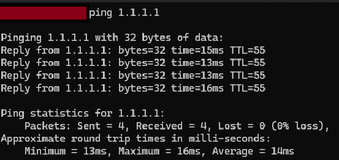
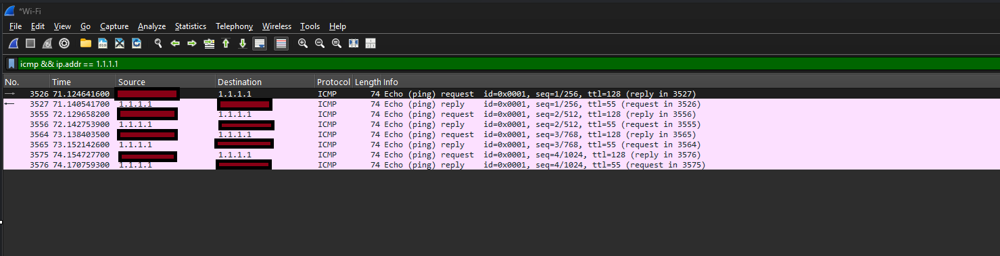
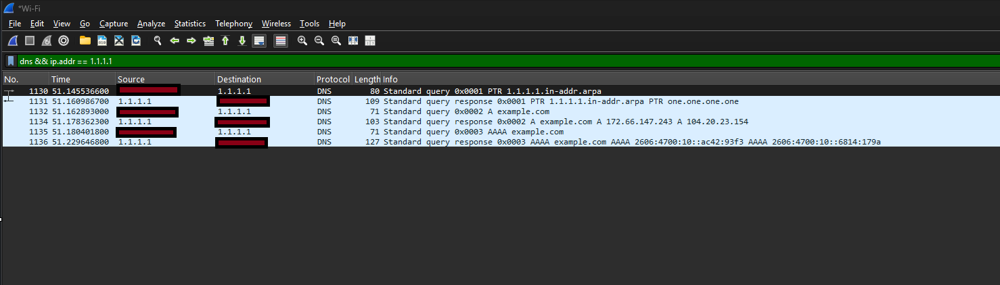
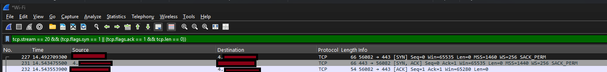

# Lab 002 — Wireshark Network Traffic Analysis

## Overview
This hands-on cybersecurity lab demonstrates network traffic capture and analysis using Wireshark on Windows. I generated controlled network traffic and examined ICMP, DNS, and TCP communications to better understand network connectivity, domain name resolution, and TCP connection establishment.

## Objectives
- Test network connectivity using Windows Command Prompt.
- Capture and inspect network packets using Wireshark.
- Identify ICMP Echo Requests and Echo Replies.
- Analyze DNS queries and responses.
- Identify the TCP three-way handshake.
- Document technical findings while protecting sensitive network information.

## Tools Used
- Wireshark 4.6.9
- Npcap 1.88
- Windows Command Prompt
- Windows Paint for screenshot redaction

## 1. Network Connectivity Test
I used Windows Command Prompt to test connectivity to Cloudflare's public DNS server at 1.1.1.1.

```cmd
ping 1.1.1.1
```

### Results
- Packets sent: 4
- Packets received: 4
- Packet loss: 0%
- Minimum round-trip time: 13 ms
- Maximum round-trip time: 16 ms
- Average round-trip time: 14 ms

All four packets received replies, confirming successful connectivity to the test destination during this test.



## 2. ICMP Packet Analysis
I captured traffic on my Wi-Fi interface and applied the following Wireshark display filter:

```text
icmp && ip.addr == 1.1.1.1
```

### Observations
- Identified four ICMP Echo Requests and four Echo Replies.
- Observed request and reply packet pairs between my computer and the destination.
- Examined protocol information and packet lengths.

This demonstrated how ICMP can be used to test network reachability and troubleshoot connectivity.



## 3. DNS Traffic Analysis
I generated DNS queries using Windows Command Prompt:

```cmd
nslookup example.com 1.1.1.1
```

I then applied this Wireshark display filter:

```text
dns && ip.addr == 1.1.1.1
```

### Observations
- Identified a PTR query and response for reverse DNS lookup.
- Identified A record queries and responses for IPv4 address resolution.
- Identified AAAA record queries and responses for IPv6 address resolution.
- Observed DNS request and response packets in Wireshark.

This demonstrated how DNS translates domain names into IP addresses and how DNS activity can be inspected during network troubleshooting.



## 4. TCP Three-Way Handshake Analysis
I captured TCP network traffic and identified a connection using HTTPS port 443.

I used the following Wireshark display filter to isolate TCP Stream 20 and examine connection-control packets:

```text
tcp.stream == 20 && (tcp.flags.syn == 1 || (tcp.flags.ack == 1 && tcp.len == 0))
```

### Observed Handshake
1. SYN — The client initiated a TCP connection.
2. SYN-ACK — The server acknowledged the request.
3. ACK — The client acknowledged the server response.

### Results
- Successfully identified the three packets of a TCP handshake.
- Observed traffic using destination port 443.
- Measured approximately 51 milliseconds between the initial SYN and final ACK.

This demonstrated how TCP establishes a reliable connection before application data is exchanged.



## Security and Privacy Considerations
- Captured traffic from my own network interface.
- Redacted identifying IP addresses and personal information from screenshots.
- Avoided publishing raw network packet captures.
- Used public test destinations to generate controlled traffic.

## Skills Demonstrated
- Network traffic analysis
- TCP/IP networking fundamentals
- ICMP troubleshooting
- DNS record analysis (PTR, A, AAAA)
- TCP three-way handshake identification
- Wireshark packet filtering
- Windows command-line networking tools
- Technical documentation and security awareness

## Conclusion
This lab strengthened my understanding of how network devices communicate and how Wireshark can be used to analyze network protocols. I gained hands-on experience troubleshooting connectivity, examining DNS activity, and identifying TCP connection establishment. These skills provide a foundation for cybersecurity, security operations, cloud security, and network administration.
